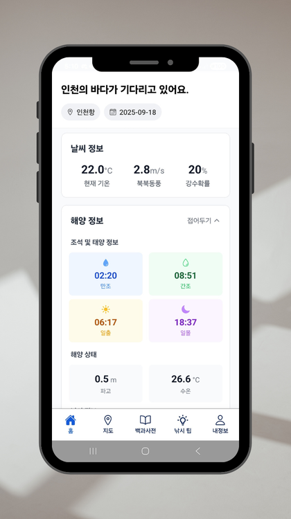
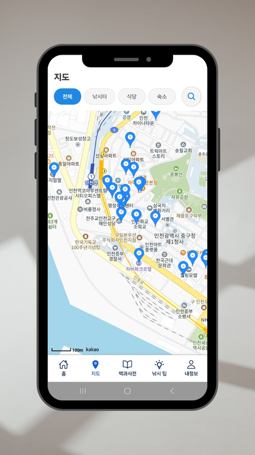
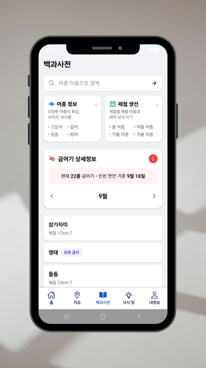
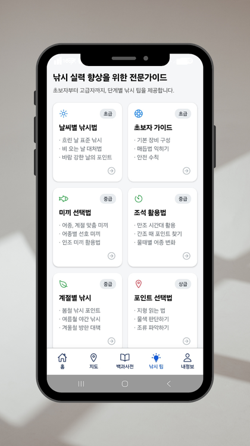
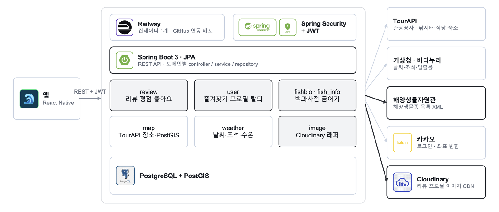

<p align="center">
  
</p>

<h1 align="center">In Sea</h1>

<p align="center">인천 낚시 관광 정보 앱 — 백엔드</p>

<p align="center">
  <a href="https://m.onestore.co.kr/v2/ko-kr/app/0001002396"></a>
  
  
</p>

<p align="center">
  
  
  
  
</p>

인천의 낚시터·식당·숙소를 지도에서 찾고, 그날의 날씨·조석과 잡아도 되는 어종(금어기)까지 한 화면에서 보는 앱.
2025 관광데이터 활용 공모전(한국관광공사) 출품작, 원스토어 출시.

> 팀 CheckMate(4인) 백엔드 저장소의 **본인 담당 모듈만** 공개한 쇼케이스. 전체 저장소는 팀 소유라 비공개이며, 이 저장소만으로는 빌드 불가.
> 팀 전체 코드 12,600줄 중 아래 5개 모듈 약 8,700줄 담당. 코드·데이터의 재배포 및 상업적 이용 불가.

- 기간: 2025.04 – 2025.10 (개발 07–09)
- 팀: 4인 — 백엔드 2 · 프론트 2
- 스택: Spring Boot 3 · Spring Data JPA · PostgreSQL + PostGIS · Spring Security + JWT · Cloudinary · Caffeine · Railway / React Native

## 팀과 역할

| 역할 | 담당 |
|---|---|
| 백엔드 (본인) | 리뷰·평점, 회원 확장(즐겨찾기·프로필·탈퇴), 물고기 백과사전, 금어기, 이미지 저장, Railway 배포·원스토어 등록, 1차 심사 보고서 |
| 백엔드 (팀원) | TourAPI 장소·지도, 날씨·해양 정보, 낚시 팁, Spring Security·JWT·카카오 로그인 기본 |
| 프론트엔드 (팀원 2) | React Native 앱 |

## 시스템 구성



- 앱 → REST + JWT → Spring Boot. 도메인별 controller / service / repository
- 외부 데이터: TourAPI(장소) · 기상청·바다누리(날씨·조석) · 해양생물자원관(어종 XML) · 카카오(로그인·좌표) · Cloudinary(이미지 CDN)
- 굵은 선이 본인 담당 모듈과 연동

## 이 저장소의 구성

```
src/main/java/checkmate/insea/
├── review/      리뷰 작성·수정·소프트 삭제·좋아요, 장소별 리뷰·종합 평점
├── user/        장소 즐겨찾기, 닉네임·이메일·비밀번호 변경, 프로필 이미지, 회원 탈퇴, 전역 예외 처리
├── fishbio/     물고기 백과사전 — 국립해양생물자원관 API 동기화, 키워드·학명·국명·과·서식지 조회
├── fish_info/   금어기 조회·검색·추천, (삭제된) 엑셀 기반 어종 정보·분류 아이콘
└── image/       Cloudinary 업로드·삭제·썸네일
src/main/resources/templates/
└── fishing-ban-data-2025.json   국립수산과학원 금어기 규정(2025.01 시행)을 직접 JSON으로 변환한 데이터
src/test/java/checkmate/insea/review/
└── PlaceRatingStatsTest · ReviewServiceStatsTest   평점 통계 증감·상태 전이 회귀 테스트 (2026-10 추가)
```

전체 앱 구조(비공개 부분 포함): `map`(TourAPI·카카오맵) · `weather`(기상청·바다누리) · `fishing_tip` · `config`(Security·JWT)

## 설계에서 결정한 것들

### 리뷰 — "장소당 1인 1리뷰"를 어떻게 지킬까

DB에 UNIQUE(place, user)를 걸면 삭제 후 다시 쓰기가 막히고, 빼면 중복이 생김. 소프트 삭제(`status = DELETED`)로 두고, 같은 장소에 다시 쓰면 삭제된 행을 되살려 덮어씀. 좋아요·신고 수는 0으로 초기화, 장소 평점 통계에서 옛 평점을 빼고 새 평점을 더함. (`review/service/ReviewService.createReview`)

### 장소 평점 — 매번 AVG 쿼리를 날리지 않기

지도 목록에서 장소 수십 개의 평점을 한 번에 보여줘야 함. `Place`에 1~5점 개수와 평균을 저장해 두고 리뷰 작성·수정·삭제 때 증감만. 읽기 비용을 줄이는 대신 쓰기 경로에서 통계를 항상 같이 갱신해야 함 — 이 조건을 놓쳐서 생긴 버그가 아래 "한계"에.

### 어종 데이터 — 엑셀을 버리고 API로

처음엔 국립수산과학원 생물종 엑셀(822종)을 파싱했는데, 통계를 뽑아 보니 771종이 한 과(科)로 묶이는 등 분류 정보가 깨져 있었음. 어종 정보·분류 아이콘 기능을 삭제하고 국립해양생물자원관 API를 100건씩 페이징으로 전부 받아 저장하는 `fishbio` 모듈로 재작성. 응답이 ISO-8859-1로 와서 한글이 깨지는 문제는 바이트를 UTF-8로 재해석해 해결. (`fish_info`에 삭제된 코드도 남겨 둠 — 왜 버렸는지가 결정의 일부)

### 금어기 — 규정을 데이터로

국립수산과학원 공개 규정(2025.01 시행)을 어종·기간·지역·금지 유형(기간/크기)으로 정리해 JSON 리소스로 넣고, 서버 시작 시 로드·수정 후 리로드 엔드포인트. 그 위에 날짜·지역별 포획 가능 어종, 어종별 연간 스케줄, 어종명 자동완성, 기간별 추천 점수, 해제 예정 어종 조회.

### 이미지 — 썸네일을 서버에서 만들지 않기

Cloudinary에 올리고, 썸네일은 서버 API 대신 URL 변환(`w_150,h_150,c_fill,g_face`)으로. 프로필 교체 시 기존 이미지는 자동 삭제.

## 알고 있는 한계

- **백과사전 동기화의 비동기 전환 미검증.** 처음 짠 버전은 단일 트랜잭션 안의 동기 루프(약 15분). 제출본은 팀원이 `@Async` + `CompletableFuture`로 바꾼 페이지 단위 `fetchAndSavePage()`를 호출하는데, 같은 클래스 안에서 자기 메서드를 직접 부르는 구조라 Spring 프록시가 적용되지 않아 `@Async`도 페이지별 `@Transactional`도 실제로는 동작하지 않을 가능성이 크고, `join()`으로 끝까지 기다리므로 요청도 그동안 잡힘. 수집기를 별도 빈으로 분리하고 작업 ID를 즉시 반환한 뒤 진행률을 조회하는 구조로 고쳐야 함.
- **평점 이중 차감 (수정 완료).** 리뷰 삭제 → 재작성 시 삭제 때 뺀 평점을 재작성 때 한 번 더 빼는 버그. 2026-10 코드 재검토에서 발견해 수정, `src/test/java/checkmate/insea/review/`에 회귀 테스트 추가. 개발 당시에는 테스트가 DB 연결 확인용 몇 개뿐이었음.
- **API 키 커밋.** 설정 파일에 키가 들어간 채 개발. 출시 1년 뒤 공개하려고 전체 이력 재작성. 첫 커밋부터 환경변수로 가야 했음.

## 타임라인

| 시기 | 내용 |
|---|---|
| 2025.04~05 | 기획, 제안서, 예비심사 통과(5/19) |
| 2025.07 | 백엔드 세팅, 금어기·어종 엔티티 |
| 2025.08 | 금어기 API, 엑셀 어종 임포트, 회원 확장 |
| 2025.09 | 리뷰, Cloudinary, 백과사전(API 전환), Railway 배포, 원스토어 등록(9/14) |
| 2025.10 | 1차 심사 제출 — 미선발 |
| 2026.10 | 평점 이중 차감 수정·회귀 테스트, 이력에서 비밀값 제거, 쇼케이스 공개 |
